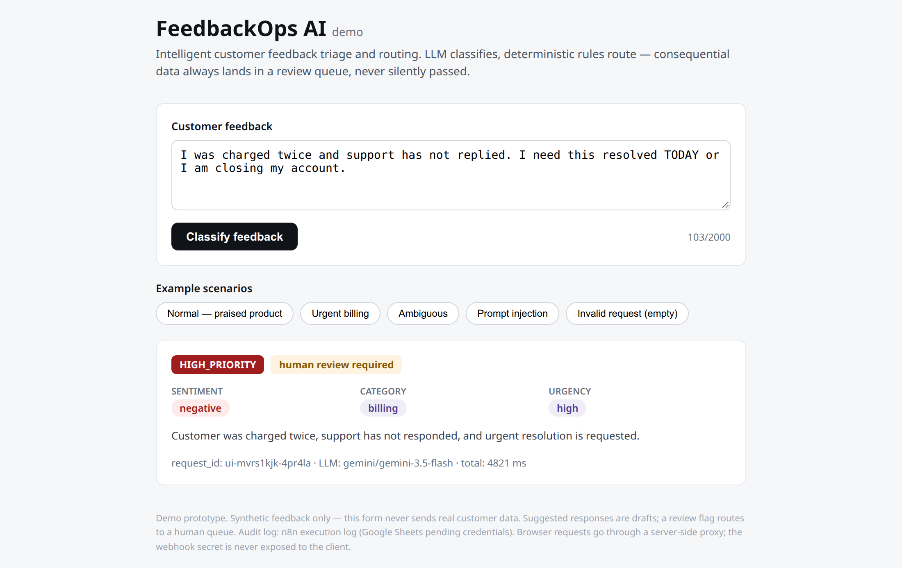
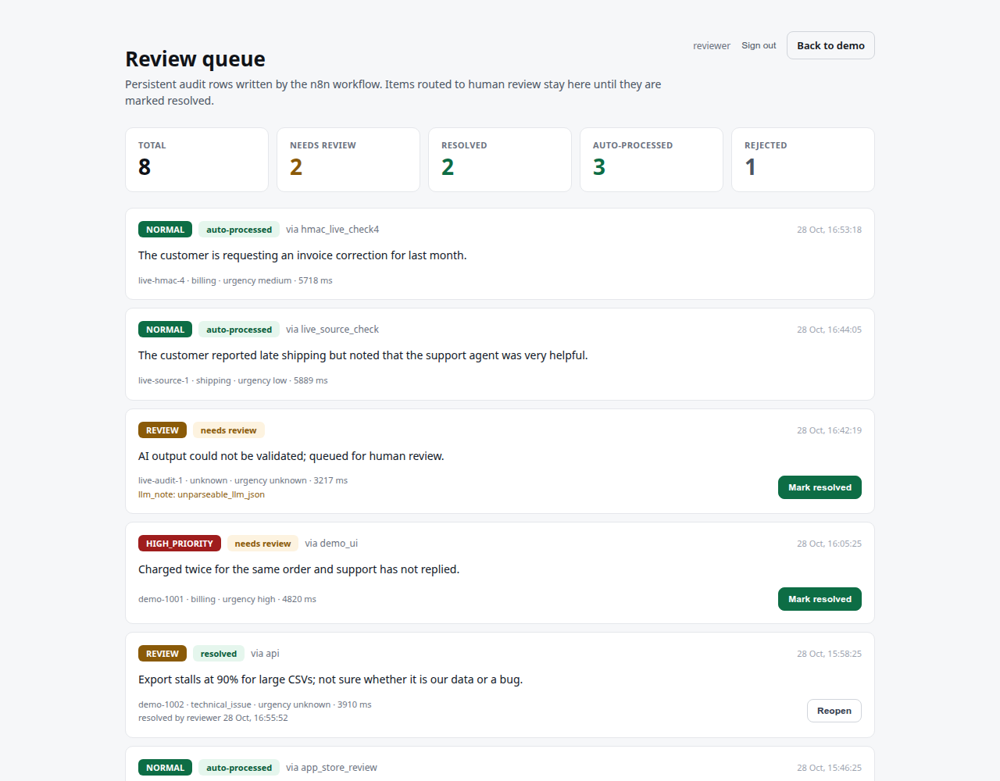

# FeedbackOps AI

**AI-powered customer feedback triage and routing — n8n + Google Gemini + Next.js.**

[](LICENSE)
[](https://n8n.io)
[](https://ai.google.dev)
[](https://nextjs.org)
[](https://www.typescriptlang.org)
[](https://github.com/maksalarina12/feedbackops-ai/actions/workflows/ci.yml)

| Demo — high-priority triage | Review queue — persistent audit rows |
|---|---|
|  |  |

FeedbackOps AI automates the first pass of customer feedback handling: it
classifies incoming messages (sentiment, category, urgency, summary), applies a
deterministic routing policy, writes an audit record, and returns structured
JSON.

The design is built around one rule: **the LLM proposes, deterministic code
disposes.** Model output is validated against a strict schema, and malformed or
untrusted output never becomes a successful classification — it fails safe into
human review.

> **Holding-company case study:** the repo is also packaged as a shared-service
> feedback triage pattern for a multi-unit group — central intake, local
> resolution, and auditable reviewer attribution. See
> [`CASE_STUDY.md`](CASE_STUDY.md) for the problem framing, operating model,
> KPI targets, rollout phases, and honest production gaps.

**Built by** [Maksalmina](https://maksalmina-arina.vercel.app) — full-stack & AI
workflow engineering · [GitHub](https://github.com/maksalarina12). See
[Author](#author) below.

---

## Table of contents

- [Why this project](#why-this-project)
- [Holding-company case study](#holding-company-case-study)
- [Features](#features)
- [Architecture](#architecture)
- [Tech stack](#tech-stack)
- [Getting started](#getting-started)
- [Configuration](#configuration)
- [API reference](#api-reference)
- [Testing and CI](#testing-and-ci)
- [Security and limitations](#security-and-limitations)
- [Project structure](#project-structure)
- [Documentation](#documentation)
- [Author](#author)
- [License](#license)

---

## Why this project

Manually triaging feedback — read, classify, prioritise, route, log — is slow,
inconsistent, and easy to drop. FeedbackOps AI handles the repetitive first pass
in seconds while keeping every decision auditable and every failure recoverable.

This repository is a complete, runnable reference implementation rather than a
mock-up: the n8n workflows are exported and importable, request authentication is
enforced, the browser never receives the shared secret, the test harness runs
against the live webhook, and CI validates the repository on every push.

For a holding company, the same problem repeats across subsidiaries: feedback is
read by different teams, routed with different standards, and logged in different
places. The pattern here — one intake, deterministic group-wide routing, a
per-unit review queue, and reviewer attribution — gives management a consistent
view without letting the model take business actions.

## Holding-company case study

[`CASE_STUDY.md`](CASE_STUDY.md) frames the project for a multi-unit group:
central intake, local resolution, management oversight, KPI targets, a phased
pilot, and the gaps that remain before production. It uses placeholders such as
`[Nama Holding]` and `[Unit Retail]` so the narrative can be branded per company
without inventing operational numbers.

## Features

- **Structured classification** — sentiment, category, urgency, and a short
  summary, returned as validated JSON.
- **Deterministic routing** — pure rule layer (`normal` / `high_priority` /
  `review`) with no LLM in the decision path.
- **Fail-safe by design** — schema violations, timeouts, and provider errors
  degrade to `review` instead of producing a wrong classification.
- **Pre-LLM validation** — invalid or oversized requests are rejected before any
  AI credits are spent.
- **Authenticated webhook** — requests must carry the `X-Webhook-Secret` header
  configured in an n8n Header Auth credential.
- **Server-side proxy** — the Next.js frontend adds the secret on the server, so
  it is never exposed to the browser.
- **Persistent audit trail** — every request is written to a SQLite store with
  idempotent `request_id` writes, PII redaction, and optional retention.
- **Authenticated review queue** — `/review` requires a signed HttpOnly session;
  items stay open until a reviewer resolves them, and actions append events
  instead of rewriting history.
- **Abuse controls** — per-IP rate limits on triage, audit, review, login, and
  Slack callbacks; optional HMAC + timestamp verification for `/api/audit`.
- **Explainable routing** — every decision ships with `routing_reasons`
  ("urgency=high -> high-priority review queue"), surfaced in the UI and the
  audit trail, so a reviewer can audit the rule that fired.
- **Unit routing (holding pattern)** — an optional `unit` field tags feedback
  for a subsidiary; `/review` filters per unit while the group audit trail
  stays unified.
- **KB-grounded suggestions (mini-RAG)** — deterministic keyword retrieval over
  an embedded knowledge base grounds suggested responses
  (`response_grounded`, `kb_source`); low-confidence matches fall back to a
  generic acknowledgement.
- **Stats dashboard** — `/stats` aggregates volume, routing, sentiment,
  categories, units, and service-quality rates from the audit store
  (counts only; message-level data stays behind reviewer sign-in).
- **Slack approvals** — escalation messages carry Block Kit buttons; Slack's
  signing-v0 HMAC is verified at `/api/slack/actions` and reviewer identity is
  recorded in the audit trail.
- **MCP audit server** — a dependency-free MCP server exposes `audit_stats`,
  `recent_audit_rows`, and `review_summary` to any MCP host (n8n agent,
  Claude) over stdio.
- **Operational visibility** — `/api/health`, structured JSON logs, and an
  explicit failure event when an audit write cannot be persisted.
- **Policy evaluation** — 30 golden routing cases run against the exported
  workflow code in CI, not a reimplementation.
- **Optional escalation** — a second workflow notifies Slack for
  `high_priority` / `review` items without changing or failing the triage response.
- **Weekly digest** — a scheduled workflow summarises the last 7 days of
  execution health.
- **Test harness** — live and mock-provider phases covering happy paths,
  validation, auth, and failure modes.
- **CI and container setup** — GitHub Actions validation plus a Docker Compose
  stack.

## Architecture

```
POST /webhook/feedbackops  (X-Webhook-Secret required)
   │
   ▼
[Validate & Normalize] ──✗──▶ [Build Error Response] ─┐
   │ valid                        (rejected pre-LLM)  │
   ▼                                                  │
[Gemini Classify] (structured output)                 │
   │                                                  ▼
[Validate LLM Output]  (schema re-check, fails safe)   │
   │                                                  │
[Deterministic Routing] (rules only, no LLM)          │
   │                                                  │
   ├──▶ [Build Success Response] ──▶ [Audit Log] ─────┴──▶ [Respond to Webhook]
   │                                     │
   │                                     └──▶ [Persist Audit] ──▶ /api/audit
   │                                                              │
   │                                                              ▼
   │                                                        /review queue
   │
   └──▶ [Prepare Escalation] ──▶ [Escalation Needed?]
                                     │ true
                                     ▼
                          [Notify Escalation] (fire-and-forget)
```

Routing policy:

| Condition | Decision |
|---|---|
| LLM error or validation failure | `review` |
| Urgency is `high` | `high_priority` |
| Any field resolves to `unknown` | `review` |
| Otherwise | `normal` |

The browser talks to `POST /api/triage` on the Next.js server. That route adds
the shared secret and forwards the request to n8n. See
[`ARCHITECTURE.md`](ARCHITECTURE.md) for node-level detail.

## Tech stack

| Layer | Technology |
|---|---|
| Orchestration | n8n 2.x (self-hosted), workflow exported as `n8n/feedbackops_ai.json` |
| LLM | Google Gemini `gemini-3.5-flash` (free tier), provider-agnostic adapter |
| Frontend | Next.js 16 + TypeScript + React 19 |
| Auth | n8n Header Auth credential + server-side proxy; per-reviewer password + signed cookie |
| Audit log | SQLite (`node:sqlite`), append-only events, idempotent writes, PII redaction |
| Review UI | Next.js server components, `/login` + `/review`, append-only resolution events |
| Automation | Optional escalation and weekly-digest n8n workflows |
| Testing | Python harness (live + mock), SQLite/API tests, 30-case policy evaluation |
| CI | GitHub Actions (validation, policy evaluation, frontend build + API tests) |
| Local stack | Docker Compose (n8n + Next.js) |

## Results

| Refresh | Check | Result | Evidence |
|---|---|---|---|
| Core | Routing policy | **30/30 (100%)** | `node scripts/evaluate_policy.mjs` executes the exported workflow code |
| Core | Routing rules + KB grounding | **8/8** | `node scripts/test_routing.mjs` (reasons + grounded cases) |
| Core | Audit store | **41/41 assertions** | SQLite idempotency, reasons, units, redaction, retention, migration, stats |
| Core | API integration | **27/27 assertions** | Built app: login, session redirects, HMAC, audit, review, Slack auth, rate limits |
| Core | Repository contract | **143/143 checks** | `python3 scripts/validate_repo.py` |
| Core | Live triage | **15/15** | Recorded Gemini run; see [`TESTING.md`](TESTING.md) |
| Core | Mock failure modes | **5/5** | Malformed output, missing field, invalid enum, timeout, 429 |
| Core | Frontend | Builds clean | `npm ci && npm run build`; Docker image builds |
| Runtime | Docker runtime | **PASS** | Container health/per-reviewer login/review; HMAC audit row survives restart |
| Runtime | Live n8n | **PASS** | 18-node workflow active; no-secret 403, HMAC audit row persisted, per-reviewer resolve |
| v2 | Slack signing | **7/7 assertions** | `node scripts/test_slack_actions.mjs` (mock-tested; no live Slack workspace) |
| v2 | MCP server | **18/18 assertions** | `node scripts/test_mcp_server.mjs` (initialize, tools/list, tools/call, errors) |
| v2 | Stats dashboard | Built & smoke-tested | `/stats` aggregates from `readAuditStats`; runs in `make test-api` |

The policy score is a **conformance test**, not a claim of model accuracy: it
checks that the exported routing code matches the intended business rules on
golden inputs. Live LLM evidence (including rate-limit and malformed-output
incidents) is in [`TESTING.md`](TESTING.md).

## Getting started

### Prerequisites

- Docker and Docker Compose
- Python 3.13+
- Node.js 24+ and npm 11+
- A Gemini API key from [Google AI Studio](https://aistudio.google.com)

### Option A — Docker Compose

```bash
cp -n .env.example .env
# set GEMINI_API_KEY, WEBHOOK_SECRET, REVIEW_USERS,
# and REVIEW_SESSION_SECRET in .env (see SETUP.md step 2)

docker compose up -d --build
```

The services start at http://localhost:5678 (n8n) and http://localhost:3000
(demo UI). The one-time workflow import and credential creation are still
required — follow [`SETUP.md`](SETUP.md) steps 3–5.

### Option B — Local processes

```bash
# 1. n8n
docker run -d --name n8n -p 5678:5678 \
  --restart unless-stopped \
  -e NODE_FUNCTION_ALLOW_BUILTIN=crypto \
  -v n8n_data:/home/node/.n8n docker.n8n.io/n8nio/n8n

# 2. environment
cp -n .env.example .env
cp -n frontend/.env.local.example frontend/.env.local
# edit both files: GEMINI_API_KEY, WEBHOOK_SECRET, N8N_WEBHOOK_URL,
# REVIEW_USERS, REVIEW_SESSION_SECRET

# 3. create n8n credentials, then build and import the workflow
python3 scripts/build_workflow.py <GEMINI_CRED_ID> "Gemini API (header auth)" \
  <WEBHOOK_CRED_ID> "FeedbackOps Webhook Auth"
curl -X POST http://localhost:5678/api/v1/workflows \
  -H "X-N8N-API-KEY: $N8N_API_KEY" \
  -H "Content-Type: application/json" \
  -d @n8n/feedbackops_ai.json

# 4. frontend
cd frontend && npm install && npm run dev   # http://localhost:3000
```

Full, verified instructions for creating the Header Auth credentials and
activating the workflow are in [`SETUP.md`](SETUP.md).

### Optional extra workflows

```bash
python3 scripts/build_extra_workflows.py \
  <WEBHOOK_CRED_ID> "FeedbackOps Webhook Auth" \
  <N8N_API_CRED_ID> "n8n API (header auth)"

# import n8n/escalation_workflow.json and n8n/weekly_digest_workflow.json
```

See [`n8n/EXTRA_WORKFLOWS.md`](n8n/EXTRA_WORKFLOWS.md) for wiring, environment
variables, and credential setup.

### Smoke test

```bash
curl -X POST http://localhost:5678/webhook/feedbackops \
  -H "Content-Type: application/json" \
  -H "X-Webhook-Secret: $WEBHOOK_SECRET" \
  -d '{"feedback":"Great service, but delivery was late.","source":"cli","request_id":"smoke-1"}'
```

## Configuration

Configuration is provided through environment variables. See
[`.env.example`](.env.example) and [`frontend/.env.local.example`](frontend/.env.local.example).

| Variable | Required | Description |
|---|---|---|
| `GEMINI_API_KEY` | Yes | Google Gemini API key |
| `GEMINI_MODEL` | No | Model name, defaults to `gemini-3.5-flash` |
| `WEBHOOK_SECRET` | Yes | Value of the `X-Webhook-Secret` header; must match the n8n Header Auth credential |
| `N8N_WEBHOOK_URL` | Yes | Webhook URL used by the frontend proxy |
| `N8N_BASE_URL` | No | n8n base URL for the weekly digest, defaults to `http://localhost:5678` |
| `ESCALATION_WEBHOOK_URL` | No | Enables the escalation side-branch when set |
| `AUDIT_WEBHOOK_URL` | No | Enables audit persistence; Compose defaults to `http://frontend:3000/api/audit` |
| `AUDIT_DB_PATH` | No | SQLite audit database, defaults to `.data/audit.sqlite` |
| `AUDIT_LOG_PATH` | No | Legacy JSONL path migrated into SQLite on first open |
| `AUDIT_HMAC_SECRET` | No | Enables HMAC + timestamp verification for `/api/audit` |
| `AUDIT_RETENTION_DAYS` | No | Deletes audit events older than this many days (empty = keep) |
| `REVIEW_USERS` | Yes (for `/review`) | JSON map of username → scrypt hash; preferred per-reviewer accounts |
| `REVIEW_USERNAME` | No | Reviewer used by `scripts/seed_demo.py`, defaults to `reviewer` |
| `REVIEW_PASSWORD` | No | Legacy shared password, used only when `REVIEW_USERS` is empty |
| `REVIEW_SESSION_SECRET` | Yes (for `/review`) | HMAC secret for the reviewer session cookie |
| `SLACK_WEBHOOK_URL` | No | Slack incoming webhook for escalation and digest messages |
| `SLACK_SIGNING_SECRET` | No | Verifies Slack interactive callbacks (approve buttons) at `/api/slack/actions` |
| `LLM_PROVIDER` | No | `gemini` (default) or `claude` |
| `LLM_TIMEOUT_SECONDS` | No | Request timeout, defaults to `30` |
| `LLM_MAX_RETRIES` | No | Retry count for transient failures, defaults to `2` |
| `MAX_FEEDBACK_LENGTH` | No | Maximum accepted input length, defaults to `2000` |
| `GOOGLE_SHEETS_DOC_ID` | No | Audit spreadsheet (optional) |
| `GOOGLE_SERVICE_ACCOUNT_EMAIL` | No | Service account for Sheets (optional) |
| `GOOGLE_SERVICE_ACCOUNT_PRIVATE_KEY` | No | Service account key (optional) |
| `ANTHROPIC_API_KEY` | No | Enables the Claude adapter |

> Never commit `.env` or `frontend/.env.local`. Both are git-ignored; only the
> example files are tracked. Never prefix server secrets with `NEXT_PUBLIC_`.

## API reference

### `POST /webhook/feedbackops`

Requires `X-Webhook-Secret`. The Next.js proxy (`POST /api/triage`) is the
recommended caller because it keeps the secret server-side.

**Request**

```http
POST /webhook/feedbackops
Content-Type: application/json
X-Webhook-Secret: <shared secret>

{
  "feedback": "The app crashes every time I upload a photo.",
  "source": "app_store_review",
  "request_id": "optional-client-id"
}
```

| Field | Type | Required | Notes |
|---|---|---|---|
| `feedback` | string | Yes | Non-empty, max `MAX_FEEDBACK_LENGTH` characters |
| `source` | string | No | Origin of the feedback |
| `request_id` | string | No | Generated when omitted; echoed in the response |

**Success response**

```json
{
  "success": true,
  "request_id": "sample-s02",
  "result": {
    "sentiment": "negative",
    "category": "technical_issue",
    "urgency": "high",
    "summary": "App crashes on photo upload."
  },
  "routing_decision": "high_priority",
  "review_required": true,
  "suggested_response": null,
  "llm": {
    "provider": "gemini",
    "model": "gemini-3.5-flash",
    "llm_error": null
  },
  "processing_duration_ms": 1830,
  "error": null
}
```

**Validation error response** — rejected before the LLM is called:

```json
{
  "success": false,
  "request_id": "smoke-1",
  "error": {
    "code": "invalid_request",
    "message": "Request failed validation. Nothing was classified and no AI credits were spent.",
    "problems": ["feedback_required"]
  },
  "processing_duration_ms": 2
}
```

**Authentication failure** — missing or wrong `X-Webhook-Secret` returns HTTP 403
from n8n; the request never reaches the classification logic.

### `POST /api/triage` (Next.js proxy)

Accepts the same JSON body and returns the upstream status and payload. It adds
`X-Webhook-Secret` server-side, caps the body at 16 KB, and times out after 45
seconds.

### `POST /api/audit` (n8n → Next.js)

Called by the workflow's `Persist Audit` side branch. Requires the same
`X-Webhook-Secret`, caps the body at 32 KB, and upserts one audit record (the
same `request_id` is written once). Optional HMAC mode requires
`X-Audit-Timestamp` and `X-Audit-Signature` (HMAC-SHA256 of
`"<timestamp>.<raw body>"`, ±5 minutes). It is fire-and-forget: a persistence
failure never changes the triage response.

### `POST /api/review` (dashboard → Next.js)

Marks a review item `resolved` or `needs_review`. Requires a valid reviewer
session, accepts same-origin browser requests only, and appends a resolution
event rather than rewriting history.

### `POST /api/auth/login` / `POST /api/auth/logout`

Username + password login for the reviewer queue. Successful login sets an
HttpOnly, SameSite=Lax session cookie carrying the reviewer identity; logout
clears it. Login attempts are rate-limited.

### `GET /review`

Server-rendered review queue showing total, needs-review, resolved, auto-processed,
and rejected counts plus the 100 most recent audit rows. Unauthenticated requests
are redirected to `/login`.

### `GET /api/health`

Returns `ok`, audit-store status, review-auth configuration, row count, and
uptime. Suitable for container health checks and uptime monitors.

### `POST /api/slack/actions` (Slack → Next.js)

Interactive callback for the escalation workflow's approve buttons. Slack's
signing-v0 HMAC is verified (stale timestamps > 5 minutes rejected), button
values map to `resolve|needs_review:<request_id>`, and the update is appended
with a `<user> (slack)` reviewer identity. Unconfigured (no signing secret)
returns 503.

### `GET /stats`

Public aggregates-only dashboard: volume per day, routing/sentiment/category/
unit distributions, review rate, rejection rate, resolution rate, KB-grounding
rate, and average processing time. No message-level content is rendered.

### MCP audit server (stdio)

`node scripts/mcp_audit_server.mjs` is a dependency-free MCP server exposing
`audit_stats`, `recent_audit_rows`, and `review_summary` over the SQLite store.
It speaks JSON-RPC 2.0 on stdin/stdout (newline-delimited) — verify with
`node scripts/test_mcp_server.mjs`.

## Testing and CI

### Offline validation (no API key, no n8n)

```bash
python3 scripts/validate_repo.py
node scripts/test_routing.mjs
node scripts/test_audit_store.mjs
node scripts/test_slack_actions.mjs
node scripts/test_mcp_server.mjs
node scripts/evaluate_policy.mjs
make test-api   # builds the frontend first
```

Checks workflow exports, connection integrity, webhook auth, absence of secret
material, proxy design, and documentation presence. The audit-store test covers
SQLite idempotency, review events, PII redaction, retention, legacy JSONL
migration, routing reasons, unit tags, and the stats aggregation. The policy
evaluation executes the exported routing code against 30 golden cases.
`make test-api` boots the built app and exercises login, auth redirects, HMAC
verification, audit writes, review actions, Slack callback auth, and rate
limits. The MCP test drives the stdio server end-to-end (initialize,
tools/list, tools/call, error codes).

### Live test harness

```bash
export N8N_API_KEY="your-n8n-api-key"
export N8N_WORKFLOW_ID="your-workflow-id"
export WEBHOOK_SECRET="your-webhook-secret"

python3 scripts/run_tests.py          # live phase
python3 scripts/run_tests.py --full   # live + mock-provider phase
```

The harness includes an auth check that sends one request without the secret and
expects HTTP 403.
Results and the evidence table are documented in [`TESTING.md`](TESTING.md).

### Continuous integration

`.github/workflows/ci.yml` runs two jobs on every push and pull request:

1. **Validate** — `compileall`, `scripts/validate_repo.py`, routing tests,
   audit-store tests, Slack-signature tests, MCP server tests, and the
   30-case policy evaluation; no secrets required.
2. **Build frontend** — `npm ci`, `npm run build`, then `scripts/test_api.mjs`
   against the built app.

## Security and limitations

- Webhook authentication is enforced with an n8n Header Auth credential.
- The shared secret never reaches the browser; the Next.js proxy injects it
  server-side, and the UI calls same-origin `/api/triage`.
- `/api/audit` requires the same secret as the webhook (optionally HMAC +
  timestamp); `/api/review` requires a reviewer session and same-origin request.
- `/review` is behind per-reviewer username/password auth with a signed HttpOnly
  session cookie; resolution events record the reviewer.
- Triage, audit, review, and login endpoints have per-IP rate limits.
- Audit rows are append-only and idempotent per `request_id`. Email addresses,
  phone numbers, and card-like numbers are redacted before storage. Review
  actions add events instead of mutating existing records.
- LLM output is treated as untrusted input and re-validated against an allowlist.
- Invalid input is rejected before the AI is called.
- No real customer data is included — all samples are synthetic and fabricated.
- This is **demo-grade**; see [`SECURITY.md`](SECURITY.md) for the explicit
  boundary between demo and production readiness.

Known gaps: SQLite and the rate limiter are single-instance, so scale-out needs
Postgres and a shared limiter; the webhook dedupe map is still in-memory; the
30-case evaluation measures policy conformance, not live Gemini accuracy; and
the optional Google Sheets path remains documented but unwired.

## Project structure

```
feedbackops-ai/
├── .github/workflows/ci.yml     # validation + frontend build
├── docker-compose.yml           # n8n + frontend
├── DEPLOYMENT.md                # public-demo runbook
├── Makefile                     # demo/seed/test shortcuts
├── docs/
│   ├── demo.png                 # real UI screenshot
│   ├── review.png               # review queue screenshot
│   ├── social-preview.png       # GitHub social preview
│   ├── eval-results.json        # generated policy evaluation
│   └── adr/                     # architecture decision records
├── n8n/
│   ├── feedbackops_ai.json      # main triage workflow
│   ├── escalation_workflow.json # optional Slack escalation
│   ├── weekly_digest_workflow.json
│   ├── WORKFLOW_GUIDE.md        # node-by-node explanation
│   └── EXTRA_WORKFLOWS.md       # optional workflow setup
├── scripts/
│   ├── build_workflow.py        # reproducible workflow builder
│   ├── build_extra_workflows.py
│   ├── run_tests.py             # live + mock test harness
│   ├── mock_gemini.py           # deterministic mock LLM
│   ├── seed_demo.py             # reproducible review-queue demo data
│   ├── hash_review_password.mjs # scrypt hash for REVIEW_USERS
│   ├── test_audit_store.mjs     # SQLite store tests
│   ├── test_api.mjs             # live API integration tests
│   ├── evaluate_policy.mjs      # exported-policy golden cases
│   └── validate_repo.py         # offline CI checks
├── samples/synthetic_feedback.json
├── frontend/
│   ├── app/                     # demo UI, /login, /review, and API routes
│   └── lib/                     # SQLite store, auth, rate limiting, logging
├── README.md
├── README_DEMO.md               # original demo-oriented README
└── LICENSE
```

## Documentation

| Document | Purpose |
|---|---|
| [`CASE_STUDY.md`](CASE_STUDY.md) | Holding-company case study, rollout, KPI targets, production gaps |
| [`SETUP.md`](SETUP.md) | Verified step-by-step environment setup |
| [`ARCHITECTURE.md`](ARCHITECTURE.md) | Design decisions and data flow |
| [`n8n/WORKFLOW_GUIDE.md`](n8n/WORKFLOW_GUIDE.md) | Workflow nodes and import steps |
| [`n8n/EXTRA_WORKFLOWS.md`](n8n/EXTRA_WORKFLOWS.md) | Escalation and weekly-digest setup |
| [`TESTING.md`](TESTING.md) | Test evidence and results |
| [`SECURITY.md`](SECURITY.md) | Security posture and production gaps |
| [`TROUBLESHOOTING.md`](TROUBLESHOOTING.md) | Common failures and fixes |
| [`DEMO.md`](DEMO.md) | Walkthrough playbook (Indonesian) |
| [`README_DEMO.md`](README_DEMO.md) | Original demo-focused README, preserved for context |
| [`DEPLOYMENT.md`](DEPLOYMENT.md) | Public-demo deployment and backup runbook |
| [`CONTRIBUTING.md`](CONTRIBUTING.md) | Local checks and contribution rules |
| [`docs/adr/`](docs/adr) | Architecture decision records |
| [`scripts/hash_review_password.mjs`](scripts/hash_review_password.mjs) | Generate per-reviewer password hashes |

## Author

Built by **Maksalmina**, a full-stack developer (TypeScript, Python,
React/Next.js, Node) delivering end-to-end client web applications since 2020,
with hands-on work in LLM-powered products and workflow automation.

- **Portfolio** — <https://maksalmina-arina.vercel.app>
- **GitHub** — <https://github.com/maksalarina12>

FeedbackOps AI is an open reference implementation of the feedback-triage
pattern I build for client operations: a day-one runnable system where the LLM
proposes, deterministic code disposes, and nothing ships without an audit trail.

## License

Released under the [MIT License](LICENSE). © 2026 Maksalmina.
